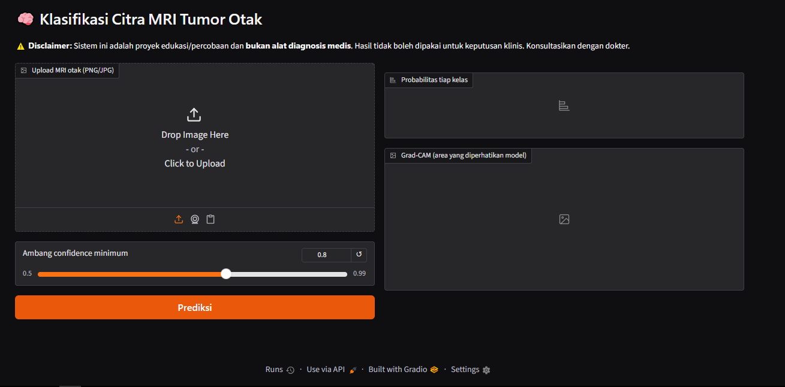

# Klasifikasi Citra MRI Tumor Otak

Proyek mata kuliah: membangun model klasifikasi tumor otak dari citra MRI, lalu membungkusnya menjadi sistem cerdas yang menerima gambar unggahan dan menampilkan prediksi beserta penjelasan visual (Grad-CAM).

[](https://colab.research.google.com/github/muhammadarifinn/ML-TempeOrek/blob/main/notebooks/TempeOrek.ipynb)


> **Disclaimer:** proyek ini untuk tujuan edukasi dan **bukan alat diagnosis medis**. Hasil prediksi tidak boleh dipakai untuk keputusan klinis.



## Ringkasan

| | |
|---|---|
| Tugas | Klasifikasi citra MRI otak |
| Model | ResNet18 (transfer learning dari ImageNet) |
| Dataset | [Brain Tumor Image Dataset (Kaggle)](https://www.kaggle.com/datasets/denizkavi1/brain-tumor) |
| Akurasi data uji | **XX.X%** (isi dari `model_meta.json`) |
| Antarmuka | Gradio (upload gambar, probabilitas, Grad-CAM) |

## Dua pipeline

**Pipeline 1: Pembuatan model** (`notebooks/TempeOrek.ipynb`)
Business understanding → data collection → EDA → data preparation → modeling → evaluation → penyimpanan model.

**Pipeline 2: Sistem cerdas** (`notebooks/TempeOrek.ipynb`, `app/app.py`)
Memuat model, validasi input, inferensi dengan pengaman (ambang confidence dan entropy), Grad-CAM, dan antarmuka Gradio.

## Hasil

Ganti bagian ini dengan hasil Anda sendiri.

| Kelas | Precision | Recall | F1 |
|---|---|---|---|
| Meningioma | - | - | - |
| Glioma | - | - | - |
| Pituitary | - | - | - |

<p>
  
  
</p>

## Struktur repositori

```
.
├── notebooks/
│   ├── 01_model_pipeline.ipynb
│   └── 02_intelligent_system.ipynb
├── app/
│   └── app.py
├── models/
│   ├── best_model.pth
│   └── model_meta.json
├── assets/                # gambar untuk README
├── requirements.txt
└── README.md
```

## Cara menjalankan

```bash
git clone https://github.com/USERNAME/NAMA-REPO.git
cd NAMA-REPO
pip install -r requirements.txt
python app/app.py
```

Lalu buka alamat lokal yang muncul di terminal (biasanya `http://127.0.0.1:7860`).

Untuk melatih ulang model, buka `notebooks/01_model_pipeline.ipynb` di Google Colab (gunakan GPU T4).

## Keterbatasan

- **Kemungkinan kebocoran data:** dataset tidak menyertakan ID pasien, sehingga irisan (slice) dari pasien yang sama bisa masuk ke data latih dan uji. Akurasi nyata kemungkinan lebih rendah.
- **Domain shift:** performa dapat turun pada gambar dari mesin atau sumber lain.
- **Pengaman input bersifat heuristik:** filter grayscale dan ambang confidence tidak menjamin gambar non-MRI selalu tertolak.
- **Hanya untuk edukasi,** bukan untuk penggunaan klinis.

## Pengembangan lanjutan

- Kelas tambahan "bukan MRI otak" untuk menolak gambar di luar domain
- Perbandingan dengan EfficientNet atau ViT
- Validasi eksternal pada dataset dari sumber lain
- Segmentasi tumor (U-Net) jika tersedia mask

## Lisensi dan atribusi

Kode dirilis di bawah lisensi MIT. Dataset milik pembuat aslinya di Kaggle; periksa lisensi dan sitasi pada halaman dataset sebelum digunakan ulang. Dataset **tidak** disertakan di repositori ini.

## Penulis

Nama Anda, Mata Kuliah, Universitas, Tahun
